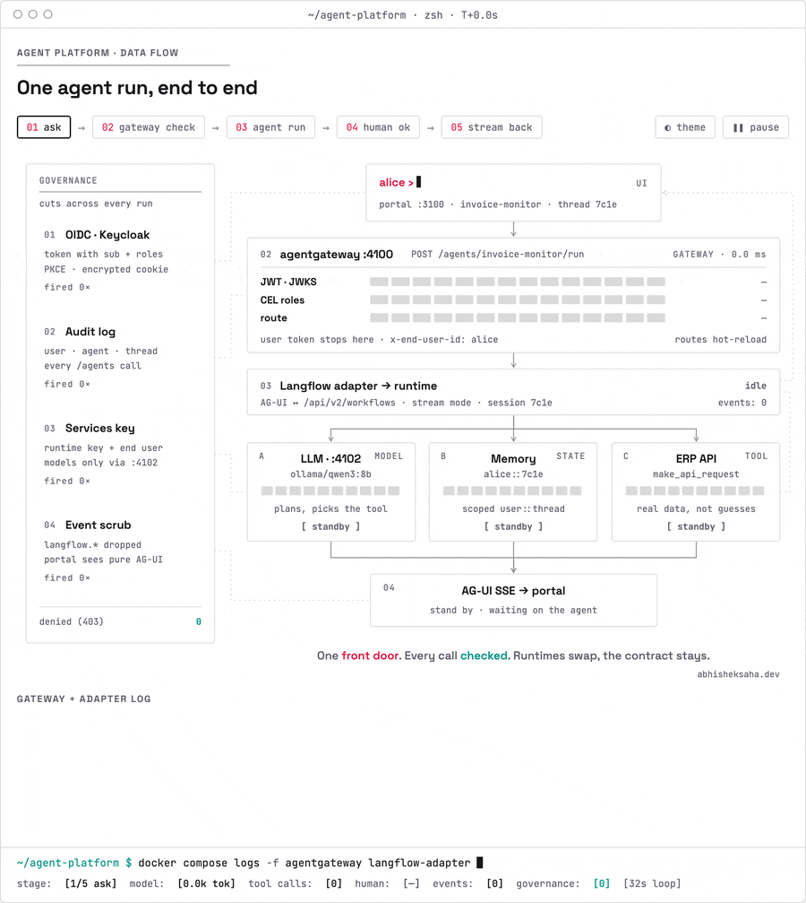

<h1 align="center">Agent Platform</h1>

<p align="center">
  <strong>One front door for every AI agent.</strong><br>
  A self-hostable portal, gateway and agent catalog: single sign-on, role-based access, governed model and tool
  calls, human approval, and an audit trail, whatever runtime an agent is built with.
</p>

<p align="center">
  <a href="https://github.com/ovsec/agent-platform/actions/workflows/ci.yml"></a>
  <a href="LICENSE"></a>
  
  
  
  
</p>

<p align="center">
  <a href="#quick-start">Quick start</a> ·
  <a href="#how-it-works">How it works</a> ·
  <a href="#building-and-shipping-agents">Build an agent</a> ·
  <a href="#human-in-the-loop">Human in the loop</a> ·
  <a href="docs/README.md">Diagrams</a>
</p>

<picture>
  <source media="(prefers-color-scheme: dark)" srcset="docs/data-flow-live-dark.gif">
  
</picture>

<p align="center"><sub>One agent run, end to end. Open the <a href="docs/data-flow-live.html">interactive version</a> in a browser to step through it.</sub></p>

---

## Why

Teams build agents with different tools: visual builders, Python frameworks, vendor SDKs. Without a shared layer,
every agent re-implements login, permissions, model keys, logging and approvals, and users hunt through a dozen
UIs. Agent Platform puts one governed entry point in front of all of them:

- **For end users:** one portal to find the right agent, chat with streaming answers and tool results, and
  approve or reject actions before they happen.
- **For agent developers:** build in the Langflow visual editor (or in code), publish in seconds, no restarts and
  no auth code to write.
- **For platform and security teams:** every call authenticated and authorised at the gateway, model and tool
  access governed centrally, and a record of who called which agent and model.

## Features

- **One contract for every agent.** Each agent is `POST /agents/{slug}/run` on the gateway: standard
  [AG-UI](https://docs.ag-ui.com) `RunAgentInput` in, AG-UI server-sent events out. The portal uses one client for
  all of them.
- **Runtime-agnostic.** [Langflow](https://www.langflow.org) is the first runtime, through a stateless AG-UI
  adapter. Native AG-UI runtimes (Pydantic AI, LangGraph, CrewAI) are forwarded as they are.
- **Identity and access built in.** Generic OAuth2/OIDC: any IdP that issues the expected claims works (Keycloak
  locally; Entra ID and others by configuration). Access is per agent, by role.
- **Governed model and tool calls.** Agents never hold provider keys. Model (`/v1/chat/completions`) and MCP calls
  go through [agentgateway](https://agentgateway.dev), which attributes them to the end user and agent.
- **Human in the loop.** Approval steps in Langflow become standard AG-UI interrupts; the portal renders one card
  for any interrupt and resumes the run.
- **Per-user memory.** Conversation memory is scoped to user and thread; one user can never resume another's run.
- **Zero-restart publishing.** Add, change or remove an agent and the route is live within seconds.
- **GitOps for agents.** Agents live in their teams' own repositories and release into a catalog through a reusable
  GitHub workflow, validated against a versioned manifest schema.

## How it works

<p align="center"></p>

| Component | Role |
|---|---|
| **Portal** (`apps/portal`) | Next.js 15 + [assistant-ui](https://www.assistant-ui.com): sign-in, agent catalog, streaming chat, tool cards and approval cards. |
| **agentgateway** | The front door. Validates tokens, enforces roles per agent, routes to the right runtime, serves governed model/MCP endpoints, and writes the audit log. |
| **Langflow adapter** (`services/langflow-adapter`) | Speaks standard AG-UI in front of the Langflow Workflow API, including pause and resume for human input. Stateless. |
| **Langflow runtime** | Runs published visual agents headlessly, with per-user memory. Clients reach it only through the gateway. |
| **Langflow Builder** | The visual editor where developers build and test flows. |
| **Identity provider** | Any OIDC IdP. Keycloak runs locally with a ready-made realm. |

**A single run** (the animation above):

1. The user asks a question in the portal. The portal forwards it with the user's access token.
2. The gateway validates the token (signature, issuer, audience), checks the user's roles against the agent's
   `access.roles`, writes an audit record, and routes the call. The user's token stops here; the runtime receives
   only the user id (`x-end-user-id`).
3. The adapter starts the Langflow flow. The agent loads its memory for this user and thread, calls the model
   through the gateway's services port, and calls its tools.
4. If an action needs approval, the run pauses and the portal shows an approval card. The decision resumes the
   run as a new, fully re-checked request.
5. AG-UI events stream back through the gateway to the portal.

More views (architecture with every port and store, step-by-step sequence diagrams) are in
[docs/README.md](docs/README.md), as SVG, editable tldraw and Mermaid.

## Quick start

### Prerequisites

| Tool | Used for |
|---|---|
| [Docker](https://docs.docker.com/get-docker/) with Compose | the whole stack |
| [uv](https://docs.astral.sh/uv/) | the Python scripts (publishing, validation, end-to-end tests) |
| [Ollama](https://ollama.com) on the host (`:11434`) | the local LLM (any model your agents use, e.g. `qwen3:8b`) |

### Run it

```bash
git clone https://github.com/ovsec/agent-platform.git && cd agent-platform
./scripts/init-env.sh                  # create .env with random secrets (once)
docker compose up -d                   # start the stack
./scripts/bootstrap-runtime-key.sh     # create the Langflow runtime API key (once; restarts the gateway once)

uv run scripts/publish.py deploy test-agents/hitl-demo --builder   # deploy the built-in test agent
uv run scripts/e2e.py                  # end-to-end check: auth, human in the loop, services key, audit
```

Open the portal at **http://localhost:3100** and sign in as `alice` / `alice`.

### Local services

| Service | URL | Notes |
|---|---|---|
| Portal | http://localhost:3100 | Branding from `BRAND` in `.env` |
| agentgateway (agents) | http://localhost:4100 | `POST /agents/{slug}/run` |
| agentgateway admin UI | http://localhost:4101/ui | "Sign in with SSO" as `admin` / `admin` |
| agentgateway services | http://localhost:4102 | LLM (`/v1/chat/completions`, `/v1/models`) and MCP (`/mcp`), configured in the admin UI |
| Langflow Builder | http://localhost:7870 | Visual editor (auto-login, loopback only) |
| Langflow Builder with login | http://localhost:7871 | oauth2-proxy; roles `agent-developer` or `agent-admin` |
| Langflow runtime | http://localhost:7880 | Headless; clients go through the gateway |
| Keycloak | http://localhost:8180 | Admin `admin`, password `KEYCLOAK_ADMIN_PASSWORD` in `.env` |
| Postgres | localhost:5440 | User `platform` |

### Test users

| User / password | Roles | Can use |
|---|---|---|
| `alice` / `alice` | `agent-user`, `finance-support` | the portal and finance agents |
| `bob` / `bob` | `agent-user` | the portal and general agents |
| `dev` / `dev` | `agent-user`, `agent-developer` | + the Langflow Builder |
| `admin` / `admin` | `agent-user`, `agent-admin` | every agent + the gateway admin UI |

> [!WARNING]
> These users and passwords are for local development only. Never expose the stack with them enabled.
> `scripts/share.sh on public` disables them automatically.

## Concepts

### The agent manifest

Every agent is a folder with an `agent.yaml` (validated against
[`schemas/agent.schema.json`](schemas/agent.schema.json), contract v1) and, for Langflow agents, a `flow.json`:

```yaml
slug: hitl-demo
name: HITL Demo
description: 'Test agent: pauses every request for a human Approve / Reject decision.'
owner_team: platform
tags: [test, hitl]
runtime: langflow              # or: agui (with agui: {host, path})
langflow:
  flow_id: 7d1e2c3b-4a5f-4e6d-9c8b-0a1b2c3d4e5f
access:
  roles: [agent-user]          # who may use it; agent-admin may use every agent
starter_prompts:
  - Please delete iFlow ZTEST_Dummy
```

The gateway routes are generated from these manifests (`scripts/gen-gateway.py`), so access rules live next to
the agent and are reviewed in its pull requests.

### Identity and access

Authentication is generic OAuth2/OIDC. The gateway accepts access tokens from any IdP that issues:

| Claim | Value |
|---|---|
| `iss` | the configured issuer (`gateway/base.yaml`) |
| `aud` | `agent-platform` |
| `sub` | the user id, forwarded to the runtime as `x-end-user-id` |
| `roles` | an array, matched against the agent's `access.roles`; roles in `platform.yaml` → `admin_roles` may use every agent |

To use another IdP, change `issuer` and `jwks` in `gateway/base.yaml` and map that IdP's roles into the `roles`
claim (Entra ID app roles already use that name).

### Runtimes

| Runtime | `runtime:` | How the gateway reaches it |
|---|---|---|
| Langflow | `langflow` | Through the Langflow AG-UI adapter: stream mode for normal flows (token streaming), background jobs for flows that can pause for a human. |
| Any native AG-UI server (Pydantic AI, LangGraph, CrewAI, …) | `agui` | Forwarded as is, to `agui.host` + `agui.path`. |

Langflow agents reach their model through the bundled **agentgateway Model component**
(`components/agentgateway`), so model keys, guardrails and usage logs stay in the gateway.

## Building and shipping agents

Agents do not live in this repository. Each team keeps its agents in its own repository, created from
[`templates/agent-template`](templates/agent-template), and releases them into an `agent-catalog` repository
([`templates/agent-catalog`](templates/agent-catalog)) through the reusable workflow
[`.github/workflows/agent.yml`](.github/workflows/agent.yml).

**Develop locally** (Builder → agent folder in your repo → local stack):

```bash
# Export a flow from the Builder into an agent folder (writes flow.json and agent.yaml)
uv run scripts/publish.py pull "<flow id | endpoint name | name in the Builder>" ../my-agents/agents/my-agent
uv run scripts/publish.py pull --file some-flow.json ../my-agents/agents/my-agent    # or import a flow file

# Validate, publish to the runtime and route it through the gateway
uv run scripts/publish.py deploy ../my-agents/agents/my-agent [--set field=value] [--builder]

uv run scripts/publish.py deploy --all          # redeploy everything in catalog/
uv run scripts/publish.py remove my-agent
```

`pull` routes the flow's model calls through the gateway. `deploy` validates the manifest, upserts the flow into the
runtime, copies it to `catalog/<slug>/` and regenerates the gateway routes. `--set field=value` sets a component
field on every node that has it, for environment-specific values that should never be committed.

**No restarts, anywhere:**

| Piece | How it picks up a change |
|---|---|
| Langflow runtime | Flows are created, updated and removed through its API and are callable immediately. |
| agentgateway | Watches its generated `config.yaml` and hot-reloads routes within seconds. |
| Portal | Reads the catalog on every request. |

**Release:** merging in an agent repository releases to stage; publishing a GitHub release promotes to prod. The
reusable workflow validates the agent and opens an auto-merging release pull request in `agent-catalog`.

A code agent works the same way: set `runtime: agui` with `agui: {host, path}` and add a `Dockerfile`.

An agent repository can also add local wiring (custom Builder components, environment variables, volumes) with
its own compose file, listed in `COMPOSE_FILE` in `.env`.

## Human in the loop

Approvals are generic across runtimes. The portal handles **standard AG-UI interrupts**: a `RUN_FINISHED` event
with `outcome: {type: "interrupt", interrupts: [...]}`, resumed by a new run with
`resume: [{interruptId, status, payload}]`. One component
([`interrupts.tsx`](apps/portal/src/components/interrupts.tsx)) renders every interrupt: decision buttons for a
single-choice schema (labels from `x-labels`), a small form for other schemas, a tool box for `reason: tool_call`,
and Cancel. Runtimes that already emit standard interrupts need nothing else.

Langflow pauses differently, so the adapter translates. It stays stateless: the interrupt id carries the Langflow
job id, request id and the event id to continue after.

| Step | Client (standard AG-UI) | Adapter → Langflow |
|---|---|---|
| Run | `POST /agents/<slug>/run` | Flow has a Human Input node or a tool with `approval_actions` → background job + `GET /{job}/events`; otherwise stream mode |
| Pause | `RUN_FINISHED` with an interrupt (`input_required` / `tool_call`, options, `expiresAt`) | `CUSTOM langflow.human_input_required` |
| Resume | New run with `resume[0].payload = {action_id}` | `POST /{job}/resume {request_id, decision}`, then events after the pause (`Last-Event-ID`) |
| Cancel | `resume[0].status = cancelled` | `POST /stop {job_id}` |

Another user cannot resume someone else's paused run (Langflow answers "job not found").

**To add an approval step** in the Builder, add a **Human Input** node, or select approval decisions in a tool
component's **Actions** table, then publish as usual; the adapter picks up the change within 30 seconds. The card
supports approve and reject; Langflow's `edit` / `respond` decisions are not offered yet.

The built-in `hitl-demo` agent (`scripts/make-hitl-demo.py`) pauses every request for a decision and needs no
model, which makes it a deterministic test.

## Sharing the local stack

`scripts/share.sh` publishes the local stack over [Tailscale](https://tailscale.com): to anyone with the link
(`on public`, via Funnel) or to your tailnet only (`on tailnet`). Keycloak roles decide what each person can use.

```bash
./scripts/share.sh on public                      # or: on tailnet
./scripts/share.sh user jane tester finance-support   # portal (+ finance agents); prints a one-off password
./scripts/share.sh user raj developer             # portal + Langflow Builder
./scripts/share.sh user mia admin                 # + gateway admin UI
./scripts/share.sh off                            # back to localhost
```

| Shared URL | Service |
|---|---|
| `https://<machine>.ts.net` | Portal, plus Keycloak's sign-in pages |
| `https://<machine>.ts.net:8443` | Langflow Builder (roles `agent-developer`, `agent-admin`) |
| `https://<machine>.ts.net:10000/ui` | Gateway admin UI (role `agent-admin`) |

The Keycloak admin console, the Builder without login, the runtime, Postgres and the gateway's agent and services
ports are never shared. `on public` disables the local test users and turns on brute-force protection. While
shared, everyone (you included) uses the shared URLs, because tokens carry the IdP's public address. Funnel must be
allowed for the machine in your tailnet policy (`funnel` node attribute).

## Repository layout

```
apps/portal/                Next.js portal: OIDC login, agent catalog, assistant-ui chat
services/langflow-adapter/  standard AG-UI (incl. human-in-the-loop interrupts) in front of the Langflow runtime
components/agentgateway/    Langflow Model component that routes every model call through the gateway
gateway/base.yaml           hand-edited gateway base: listeners, OIDC JWT validation, CORS
gateway/config.yaml         generated by scripts/gen-gateway.py (never committed)
platform.yaml               platform-wide settings (admin roles), read by the gateway generator and the portal
schemas/agent.schema.json   agent manifest contract v1
test-agents/hitl-demo/      the platform's own deterministic test agent
catalog/                    agents deployed to the local stack (gitignored)
infra/keycloak/             local OIDC realm "agents" with test users
infra/postgres/init.sql     databases: keycloak, langflow_builder, langflow_runtime, portal
scripts/                    setup, publishing, validation, end-to-end tests, sharing, GitHub setup
templates/                  agent-template and agent-catalog repositories (created by scripts/github-setup.sh)
.github/workflows/          ci.yml (this repo) and agent.yml (reusable: validate + release, called by agent repos)
docs/                       diagrams: components, architecture, data flow (SVG, tldraw, Mermaid, animated)
```

## Troubleshooting

<details>
<summary><strong>Runtime calls fail with "Invalid API key" after recreating a Langflow container</strong></summary>

Recreating a container can give it a new IP address, and the gateway keeps the old one until it restarts. Run
`docker compose restart agentgateway` after recreating Langflow containers. (Kubernetes Services have stable
addresses, so this only affects the local stack.)
</details>

<details>
<summary><strong>The gateway restarts during startup</strong></summary>

agentgateway fetches the IdP's signing keys (JWKS) at startup, so it waits for Keycloak's health check and restarts
if the fetch fails. The bootstrap script also restarts it once, because the runtime key file starts empty. Normal
configuration changes are hot-reloaded.
</details>

<details>
<summary><strong>Keycloak realm changes don't apply</strong></summary>

The realm is imported only into an empty database. Stop Keycloak, drop and recreate the `keycloak` database, and
start it again. Then sign out and back in: old tokens were signed with keys that no longer exist.
</details>

<details>
<summary><strong>Langflow rejects <code>LANGFLOW_SECRET_KEY</code></strong></summary>

`LANGFLOW_SECRET_KEY` must be a Fernet key (32 bytes, URL-safe base64). `scripts/init-env.sh` generates one.
</details>

<details>
<summary><strong>Tool cards show "running…" until the answer arrives</strong></summary>

Langflow sends `TOOL_CALL_RESULT` only just before the final answer, and with the assistant message's id. The
portal handles it; the card completes when the result arrives.
</details>

<details>
<summary><strong>Tokens are missing the expected claims</strong></summary>

The realm defines its own client scope (`agent-platform`); `sub`, `aud` and `roles` come from that scope's mappers,
not from Keycloak's built-in scopes.
</details>

The Langflow Workflow API is in beta; its request format is isolated in `services/langflow-adapter`.

## Roadmap

- Native code runtimes behind the same contract: Pydantic AI, LangGraph, CrewAI.
- Shared MCP tools every runtime can use, governed by the gateway.
- Catalog database for the portal (in place of reading manifests from disk).
- Stage and production deployments from `agent-catalog`.
- Edit and free-text responses in approval cards.

## Contributing

Contributions are welcome. Please [open an issue](https://github.com/ovsec/agent-platform/issues) to discuss larger changes first.

1. [Fork the repository](https://github.com/ovsec/agent-platform/fork) and create a branch.
2. Make your change. If it touches the gateway or authentication, run `uv run scripts/e2e.py` against the local
   stack.
3. Changes to the agent contract (`schemas/agent.schema.json`, `.github/workflows/agent.yml`) must be backwards
   compatible, or ship as a new major version with a migration note for agent teams.
4. Open a pull request; CI validates the test agents, generates the gateway config and builds the portal.

## License

Agent Platform is licensed under the [Apache License 2.0](LICENSE).

Third-party components keep their own licenses, including [agentgateway](https://github.com/agentgateway/agentgateway),
[Langflow](https://github.com/langflow-ai/langflow), [Keycloak](https://github.com/keycloak/keycloak) and
[assistant-ui](https://github.com/assistant-ui/assistant-ui).
