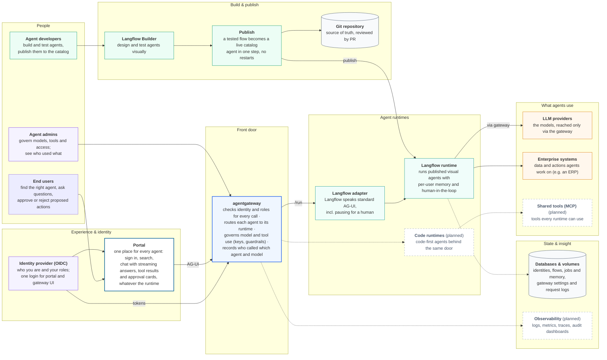
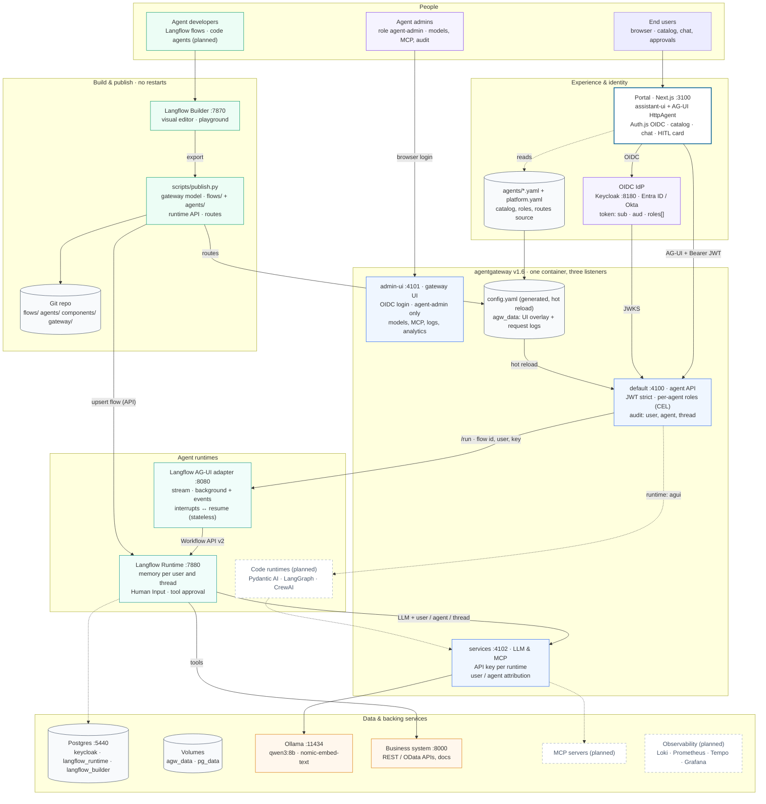
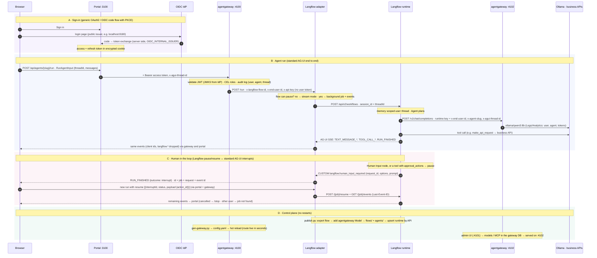

# Diagrams

Three views of the agent platform, each in three formats:

| View | What it shows | SVG (polished) | tldraw (editable) | Mermaid (text, renders on GitHub) |
|---|---|---|---|---|
| Components | high-level parts and what each one is for | [components.svg](components.svg) | [components.tldr](components.tldr) | [components.mmd](components.mmd) |
| Architecture | services, ports, listeners, stores, publish path | [architecture.svg](architecture.svg) | [architecture.tldr](architecture.tldr) | [architecture.mmd](architecture.mmd) |
| Data flow | sign-in, agent run, human in the loop, control plane, step by step | [data-flow.svg](data-flow.svg) | [data-flow.tldr](data-flow.tldr) | [data-flow.mmd](data-flow.mmd) |

Open a `.tldr` file at tldraw.com (menu → Open file) or in the tldraw desktop / VS Code extension. The tldraw versions
use automatic elbow arrows; drag an arrow to tidy a route, the SVGs are the hand-checked layout.

## Regenerate

```bash
python3 docs/make-components.py docs/components.svg docs/diagram-specs/components.json
python3 docs/make-data-flow.py  docs/data-flow.svg  docs/diagram-specs/data-flow.json
# architecture.svg is hand-written; its tldraw layout is docs/diagram-specs/architecture.json

# .tldr from the layout specs (validated against tldraw's schema)
npm i --prefix /tmp/tldr @tldraw/tlschema@5.5.2 @tldraw/store@5.5.2 @tldraw/utils@5.5.2
for d in components architecture data-flow; do
  NODE_PATH=/tmp/tldr/node_modules node docs/make-tldr.mjs docs/diagram-specs/$d.json docs/$d.tldr
done
```

The Mermaid files are written by hand; keep them in step when the platform changes.

## Components and their purpose



## System architecture



## Data flow


